<p align="center">
  
</p>

<h1 align="center">Orbit Actions</h1>

<h3 align="center">
  <a href="https://github.com/kando-menu/kando">Kando</a>, rewritten from scratch as a native Windows app
</h3>

<p align="center">
  The same radial menu, themes and <code>menus.json</code> as Kando, without Electron.<br>
  One small Rust process instead of four Chromium processes: 25 MB of memory instead of 446 MB.
</p>

<p align="center">
  <a href="https://github.com/Goldingeng/Orbit-Actions/releases/latest"><b>Download</b></a>
  &nbsp;·&nbsp;
  <b>English</b> | <a href="README.ru.md">Русский</a>
</p>

---

Orbit Actions is a fork of [Kando](https://github.com/kando-menu/kando) by Simon Schneegans. It is not a wrapper but a native rewrite. The interaction model, the five menu themes and the configuration format are the same as in Kando, but instead of Electron it runs as one small Win32 process. It is an independent project and is not affiliated with or endorsed by the Kando project.

## Download

Everything is on the [Releases](https://github.com/Goldingeng/Orbit-Actions/releases/latest) page. There are two options.

**Installer** - `Orbit-Actions-<version>-setup.exe`. The right choice for most people. One file for every PC: it detects whether you run x64, ARM64 or 32-bit Windows and installs the matching build. No administrator rights are needed; the program goes to `%LOCALAPPDATA%\Orbit Actions`. The installer adds a Start menu shortcut, can start Orbit Actions with Windows, and registers an uninstaller under Settings → Apps. A new version can be installed over the old one and keeps your menus and settings. Uninstalling keeps them too.

**Archive** - for when you don't want to install anything, for example on a USB stick:

| File | For |
|---|---|
| `Orbit-Actions-<version>-windows-x64.zip` | Regular 64-bit PCs with Intel and AMD processors |
| `Orbit-Actions-<version>-windows-arm64.zip` | Windows on ARM: Snapdragon, Surface Pro X and similar |
| `Orbit-Actions-<version>-windows-x86.zip` | Older 32-bit Windows |

Unpack the archive into any folder and run `orbit-actions.exe`. All icons, fonts, themes, sounds and translations are built into the exe, and menus and settings are stored next to it. To start the menu with Windows, put a shortcut to `orbit-actions.exe` into the `shell:startup` folder.

There are no Linux or macOS builds. The program is written directly against the Win32 API; the reasons are explained below.

### If Windows Defender removed the program

Defender sometimes flags `orbit-actions.exe` as `Trojan:Win32/Bearfoos.A!ml` by mistake. The `!ml` suffix means it is a guess by a machine-learning model, not a detected virus. It is triggered because an unsigned program installs a global keyboard and mouse hook and adds itself to startup, which the radial menu needs to open on a hotkey above any window. The full source code is in this repository, and the files have been submitted to Microsoft as a false positive.

To get the program back:

1. Open Windows Security → Virus & threat protection → Protection history.
2. Find the `Trojan:Win32/Bearfoos.A!ml` entry for `orbit-actions.exe`.
3. Click Actions → Restore. The startup shortcut and the entry in Apps come back with the file.
4. Run `orbit-actions.exe` or the Orbit Actions shortcut in the Start menu.

To check the file yourself, compare its SHA-256 with `SHA256SUMS.txt` from the release, or build the program from source, see [Building](#building).

On the first run of the installer, SmartScreen may show "Windows protected your PC" because the file is not digitally signed yet. Click More info → Run anyway.

## How much lighter than Kando

Both programs were measured on the same PC, with the same `menus.json` and `config.json`, by the same script.

- PC: AMD Ryzen 7 7700, 64 GB RAM, Windows 11 Home 26200
- Kando 3.0.1, the official `Kando-win32-x64-3.0.1.zip`
- Orbit Actions 0.1.5, x64 release build
- Date: November 7, 2026

| Metric | Orbit Actions | Kando 3.0.1 | Difference |
|---|---|---|---|
| Memory at idle (working set) | 25.2 MB | 446 MB | 18x less |
| Private memory at idle | 6.3 MB | 295 MB | 47x less |
| Memory with the menu open | 27.2 MB | 443 MB | 16x less |
| Memory after opening the menu 20 times | 27.6 MB | 460 MB | 17x less |
| Memory with settings open | 137 MB | 653 MB | 4.8x less |
| Startup until ready | 38 ms | 2,413 ms | 64x faster |
| Opening the menu from a command | 33 ms | 109 ms | 3.3x faster |
| Size on disk | 15.6 MB (2 files) | 406 MB (255 files) | 26x smaller |
| Processes | 1 | 4 | 4x fewer |
| Threads at idle | 12 | 169 | 14x fewer |
| Handles at idle | 419 | 2,533 | 6x fewer |
| CPU usage at idle (over 60 s) | 0 % | 0.013 % | Orbit Actions uses no CPU at all |

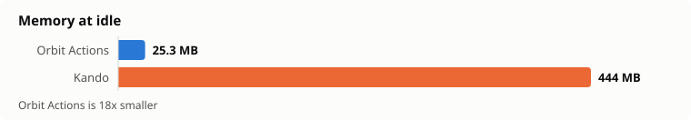
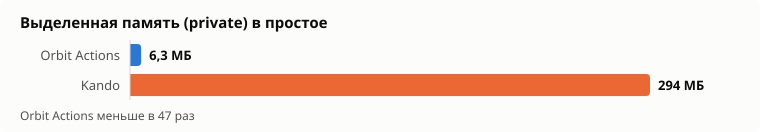
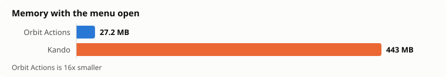
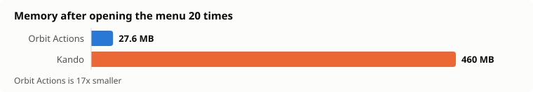
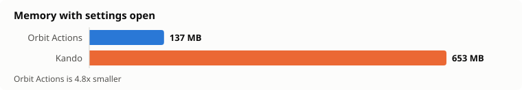
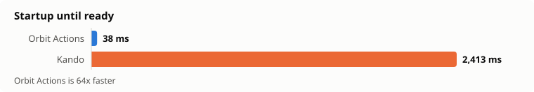
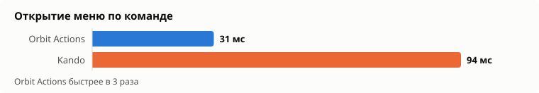
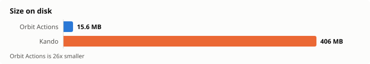
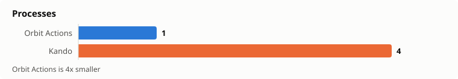
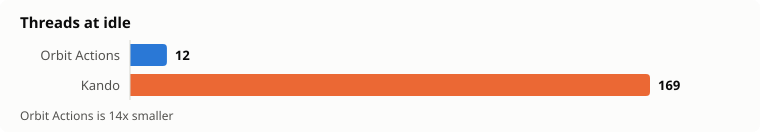
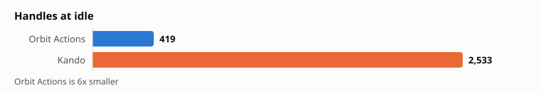

### How the numbers were measured

Everything is done by [`tools/bench.ps1`](tools/bench.ps1). The raw results are in [`docs/results.json`](docs/results.json), and [`tools/charts.js`](tools/charts.js) draws the charts from them in English and Russian.

- **Memory, threads, handles** - the sum over all processes of the program. For Kando that is the main Electron process plus the GPU, network and renderer processes. Working set is the physical memory in use right now, including shared system libraries. Private is the memory that belongs only to this program.
- **Idle** - 20 seconds after start. CPU is the processor time used over the next 60 seconds.
- **Startup** - from launching the exe until the program has opened its IPC port and accepts connections. Both programs write this port to `%APPDATA%\kando\ipc-info.json`. The median of 5 runs. Kando's first cold start took 21.3 s and is not part of the median.
- **Opening the menu** - from calling `exe --menu "<name>"` until the menu window is visible, the median of 5 runs. This includes starting a second instance that passes the command to the running one. A hotkey skips that step, so both programs open faster that way.
- **Settings** - memory 8 seconds after `--settings`. In Orbit Actions this is a separate `orbit-actions-settings.exe`. Most of its memory is the graphics card's OpenGL driver. The process only lives while the settings window is open.
- **Size on disk** - for Orbit Actions the two exe files, for Kando the unpacked folder from the zip.

To repeat the measurements:

```powershell
powershell -ExecutionPolicy Bypass -File tools\bench.ps1 -Kando "C:\path\to\unpacked\Kando"
node tools\charts.js
```

The script closes both programs, starts them one after the other and opens the menu by itself. Don't touch the mouse and keyboard while it runs (about 6 minutes). The script reads Kando's configuration from `%APPDATA%\kando`, so put the same `menus.json` and `config.json` there first.

## How it works

Two executables:

- `orbit-actions.exe` - the menu itself. Always running, uses about 6 MB of private memory.
- `orbit-actions-settings.exe` - the settings window. Runs only while you edit your menus.

The menu is one invisible layered window (`WS_EX_LAYERED`) on top of everything else. Each frame is drawn in software by [tiny-skia](https://github.com/RazrFalcon/tiny-skia) into a plain buffer and shown with a single `UpdateLayeredWindow` call with per-pixel transparency. There is no browser engine, DOM, CSS or JavaScript: the geometry, the animations and Kando's five themes are rewritten as Rust code.

Input comes from global mouse and keyboard hooks (`WH_MOUSE_LL`, `WH_KEYBOARD_LL`), `RegisterHotKey` for shortcuts and XInput for gamepads. While the menu is open it only takes the keys it uses, such as letters, digits, arrows, Enter and Esc. Shortcuts with Ctrl, Shift, Alt or Win and keys like Print Screen still reach other programs. If the program is started a second time, it finds the running instance, passes the command to it with `WM_COPYDATA` and exits. For compatibility with external Kando scripts, the same WebSocket API (`show-menu`, `show-custom-menu`) is available on a local port.

The settings window is built with [egui](https://github.com/emilk/egui) on OpenGL, with a Windows 11 Mica backdrop.

## Security

A radial menu that can run commands needs clear trust boundaries. Your own `menus.json` is trusted: whatever it says is what runs, like any automation script. Everything that comes from elsewhere is checked.

- **Imported menus.** Before a menu file is imported in the settings window, Orbit Actions lists every action in it that runs a command, opens a file, opens a link that is not `http`, `https` or `mailto`, sends a WebSocket message, changes the clipboard, presses keys or plays a macro, including actions that run on hover, and asks whether to import it.
- **Menus sent by other programs.** Scripts can show their own menus through the local WebSocket API (`show-custom-menu`). Items of such a menu are marked as remote. Before a remote item runs one of the actions above or opens any link, including `http` and `https`, Orbit Actions hides the menu and asks. Templates such as `{{window_name}}` are filled in before the check, so the prompt shows exactly what will run and a new value asks again. The answer is remembered for that exact action in `trusted-actions.json` next to the program.
- **Local WebSocket API.** It listens on `127.0.0.1` only, on a random port. Connections from web pages are refused, since browsers always send an `Origin` header and local scripts do not. At most 16 clients and 1 MB per message are accepted, and a client that stays silent for 30 seconds is disconnected.
- **Command templates.** When `{{app_name}}` or `{{window_name}}` is used in a command, only letters, digits, spaces and `. , - _ : + # @ [ ] / \` are kept from the substituted text, so a window or tab title cannot inject its own command into `cmd`, PowerShell or any other shell.
- **No data leaves your PC** except the optional update check against `api.github.com`. There is no telemetry, keys are never logged, and updates are never downloaded or run automatically.

## What makes it fast and small, and why

| Technique | Why |
|---|---|
| Native Win32 instead of Electron | Electron starts a whole Chromium: several processes, hundreds of megabytes and seconds to start. That is where Kando's 446 MB at idle comes from. |
| Software rendering with tiny-skia + `UpdateLayeredWindow` | A transparent round menu needs neither a GPU context nor a browser compositor. A menu frame is a few hundred kilobytes of pixels; the CPU draws it before a graphics card would even wake up. |
| Settings in a separate process | The settings UI needs OpenGL and egui, about 120 MB. Inside the menu process that memory would be taken all the time. A separate exe gives it back to the system as soon as the window closes. |
| Frame timer only while animating | The 8 ms timer runs only while something moves, and stops when the menu is still or closed. So no CPU is used at idle. |
| `timeBeginPeriod(1)` only while the menu is open | A precise system timer is needed for smooth animation, but at idle it keeps the CPU from sleeping and drains laptop batteries. It is turned on when the menu opens and off when it closes. |
| Gamepad polling only while the menu is open | XInput is polled every 16 ms, only while the menu is on screen. |
| Fonts warmed up in the background at start | The Material Symbols and Simple Icons fonts are parsed on a separate thread, so the first menu doesn't wait for them. |
| Icons as font glyphs, not thousands of SVG files | Thousands of Material and Simple Icons are stored as two TTF fonts with a name → glyph table and drawn at exactly the needed size. |
| Size-limited caches | The icon mask cache is cleared after 4 MB or 256 entries, so memory doesn't grow over time. After opening the menu 20 times it grew by only 0.4 MB. |
| One frame buffer for the whole lifetime | The window's DIB buffer is created once and only grows when needed instead of being allocated every frame. |
| Sounds via `PlaySoundW` from memory | Short WAV files are played by a system call, without an audio engine. |
| All resources inside the exe | Translations, themes, icons, sounds and fonts are embedded with `include_bytes!`. No hundreds of small files and no disk reads at startup. |
| Release build: LTO, `codegen-units = 1`, `panic = "abort"`, `strip` | A smaller and faster exe: the compiler optimizes the whole program at once and drops unwinding tables and debug symbols. |
| SVG instead of PNG | Interface images are vector graphics rendered at exactly the needed size and DPI instead of scaled bitmaps. |

## What is missing and why

- **Custom CSS menu themes.** In Kando the menu is drawn by Chromium, so a theme can be any HTML and CSS. Supporting that here would mean embedding WebView2, which costs well over 100 MB of memory and several extra processes. That defeats the point of this fork, so only the five built-in themes are available: Default, Clean Circle, Neon Lights, Purity and Rainbow Labels. They are drawn natively, with color presets and light and dark variants.
- **CSS themes for the settings window.** Same reason: the settings window is built with egui, not in a browser. Instead of themes it has a monochrome palette on a Mica backdrop.
- **Videos in the introduction and the sakura backgrounds of the settings window.** These are part of Kando's own look. Videos would need a separate media stack to decode, for little benefit. The introduction uses SVG illustrations instead.
- **Achievements.** They add statistics and notifications without making the menu more useful. That is extra code and background work.
- **Linux and macOS.** The menu, input, windows, tray and application icons are written directly against the Win32 API, which is how it gets down to one light window and zero background load. Other systems would need all of that rewritten for X11/Wayland and Cocoa. Kando itself is still there for Linux and macOS.
- **PNG resources.** The interface uses only SVG and WebP: SVG stays sharp at any scale, and WebP takes less space.

## Features

Menu (`orbit-actions.exe`):

- Radial layout with fixed angles, submenus, parent distance and monitor clamping
- Click selection, marking mode, turbo mode, gestures, keyboard and gamepad (XInput) input
- Five menu themes with color presets, light and dark variants, selection wedges and quick-select key hints
- Sound themes with volume and pitch
- Icons: Material Symbols Rounded, Simple Icons (plain and colored), built-in action icons, emoji, base64 images, installed applications and user icon folders
- Actions on select, open, hover and activate: close menu, close submenu, delay, execute command, execute macro, focus window, inhibit shortcuts, open file, open menu, open settings, open URI, send WebSocket message, set clipboard, simulate hotkey
- Menu conditions by application, window title and screen area. Application and title rules are plain text (several variants separated by `|`) or regular expressions in Kando style, such as `/^Code$/i`
- On-screen settings button, tray menu, `orbit-actions://` links, update check
- Optional Alt + left click trigger
- Commands that run `.bat` and `.cmd` files open in their own console. Other commands run without a window.

Settings (`orbit-actions-settings.exe`):

- Menu list with collections, search, import and export
- Interactive menu preview with drag and drop, angle locks and item templates
- Item, menu and workflow editors with hotkey and macro recording, application and window pickers
- General settings, menu theme settings, introduction, undo and redo
- Translations for 30 languages

## Configuration

Menus and settings are stored in `menus.json` and `config.json` next to the program. The format is compatible with Kando 3, so an existing Kando configuration can be copied over as is. On the first start Orbit Actions also picks up `%APPDATA%\kando\menus.json` if it exists.

## Building

You need Rust (stable) and Visual Studio Build Tools with the C++ workload.

```
cargo build --release
```

Other architectures:

```
rustup target add i686-pc-windows-msvc aarch64-pc-windows-msvc
cargo build --release --target i686-pc-windows-msvc
cargo build --release --target aarch64-pc-windows-msvc
```

For ARM64, add the "MSVC ARM64 build tools" component in the Visual Studio Installer.

The installer is built with [Inno Setup 6](https://jrsoftware.org/isinfo.php) from `installer/orbit-actions.iss` once all three builds are done:

```
iscc installer\orbit-actions.iss
```

The finished `Orbit-Actions-<version>-setup.exe` appears in `target\installer`.

`assets/material.ttf`, `assets/simple.ttf` and the icon tables are generated by `tools/icons.py` (needs `fonttools` and `brotli`).

## License

Orbit Actions is released under the MIT License, see [LICENSE](LICENSE). It is based on Kando, which is MIT licensed as well. Third-party assets keep their own licenses, see [THIRD_PARTY.md](THIRD_PARTY.md).
