# Orbit Actions

[English](README.md) | **Русский**

Быстрое круговое меню для Windows, написанное на Rust.

Orbit Actions - форк [Kando](https://github.com/kando-menu/kando) Саймона Шнеганса. Это не обёртка, а переписанная заново нативная программа. Модель взаимодействия, пять тем меню и формат конфигурации остались как в Kando, но вместо Electron теперь один небольшой процесс Win32. Проект независимый, проект Kando его не поддерживает и не одобряет.

## Скачать

Всё лежит на странице [Releases](https://github.com/Goldingeng/Orbit-Actions/releases/latest). Есть два варианта.

**Установщик** - `Orbit-Actions-<версия>-setup.exe`. Подходит большинству. Один файл для всех ПК: он сам определяет, x64 у вас, ARM64 или 32-битная Windows, и ставит нужную сборку. Права администратора не нужны, программа ставится в `%LOCALAPPDATA%\Orbit Actions`. Установщик добавляет ярлык в меню «Пуск», может включить автозапуск вместе с Windows и регистрирует удаление в «Параметры → Приложения». Новую версию можно ставить поверх старой: меню и настройки сохранятся. При удалении они тоже остаются на месте.

**Архив** - для тех, кому установка не нужна, например для флешки:

| Файл | Для чего |
|---|---|
| `Orbit-Actions-<версия>-windows-x64.zip` | Обычные 64-битные ПК с процессорами Intel и AMD |
| `Orbit-Actions-<версия>-windows-arm64.zip` | Windows на ARM: Snapdragon, Surface Pro X и т. п. |
| `Orbit-Actions-<версия>-windows-x86.zip` | Старые 32-битные Windows |

Распакуйте архив в любую папку и запустите `orbit-actions.exe`. Все иконки, шрифты, темы, звуки и переводы встроены в exe, а меню и настройки хранятся рядом с ним. Чтобы меню стартовало вместе с Windows, положите ярлык на `orbit-actions.exe` в папку `shell:startup`.

Сборок для Linux и macOS нет. Программа написана напрямую на Win32 API, причины объяснены ниже.

### Если Windows Defender удалил программу

Defender иногда ошибочно определяет `orbit-actions.exe` как `Trojan:Win32/Bearfoos.A!ml`. Пометка `!ml` означает, что это догадка машинного обучения, а не найденный вирус. Её вызывает то, что неподписанная программа ставит глобальный перехват клавиатуры и мыши и добавляется в автозапуск: без этого круговое меню не может открываться по горячей клавише поверх любых окон. Исходный код программы полностью открыт в этом репозитории, а файлы отправлены в Microsoft на проверку как ложное срабатывание.

Как вернуть программу:

1. Откройте «Безопасность Windows» → «Защита от вирусов и угроз» → «Журнал защиты».
2. Найдите запись `Trojan:Win32/Bearfoos.A!ml` с файлом `orbit-actions.exe`.
3. Нажмите «Действия» → «Восстановить». Вместе с файлом вернутся ярлык автозапуска и запись в «Приложениях».
4. Запустите `orbit-actions.exe` или ярлык Orbit Actions в меню «Пуск».

Если хотите проверить файл сами, сравните его SHA-256 с `SHA256SUMS.txt` из релиза или соберите программу из исходников, см. раздел «Сборка».

SmartScreen при первом запуске установщика может показать «Windows защитила ваш компьютер», потому что у файла пока нет цифровой подписи. Нажмите «Подробнее» → «Выполнить в любом случае».

## Насколько он легче Kando

Оба приложения замерены на одном ПК, с одним и тем же `menus.json` и `config.json`, одним и тем же скриптом.

- ПК: AMD Ryzen 7 7700, 64 ГБ ОЗУ, Windows 11 Home 26200
- Kando 3.0.1, официальный zip `Kando-win32-x64-3.0.1.zip`
- Orbit Actions 0.1.0, сборка x64 release
- Дата: 7 ноября 2026

| Показатель | Orbit Actions | Kando 3.0.1 | Разница |
|---|---|---|---|
| Память в простое (working set) | 25,3 МБ | 444 МБ | в 18 раз меньше |
| Выделенная память (private) в простое | 6,3 МБ | 294 МБ | в 47 раз меньше |
| Память с открытым меню | 27,3 МБ | 445 МБ | в 16 раз меньше |
| Память после 20 открытий меню | 27,8 МБ | 462 МБ | в 17 раз меньше |
| Память с открытыми настройками | 129 МБ | 659 МБ | в 5,1 раза меньше |
| Запуск до готовности | 36 мс | 2 297 мс | в 64 раза быстрее |
| Открытие меню по команде | 31 мс | 94 мс | в 3 раза быстрее |
| Размер на диске | 15,5 МБ (2 файла) | 406 МБ (255 файлов) | в 26 раз меньше |
| Процессы | 1 | 4 | в 4 раза меньше |
| Потоки в простое | 12 | 169 | в 14 раз меньше |
| Дескрипторы в простое | 422 | 2 535 | в 6 раз меньше |
| Загрузка CPU в простое (за 60 с) | 0 % | 0,013 % | Orbit Actions не тратит процессор вообще |

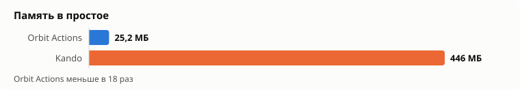
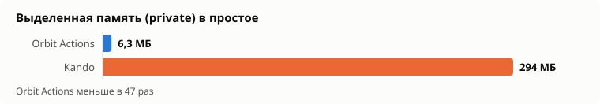
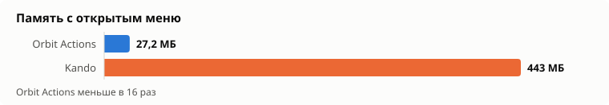
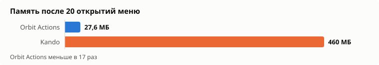
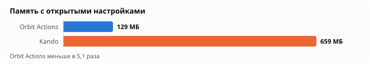
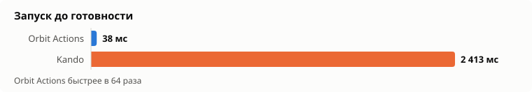
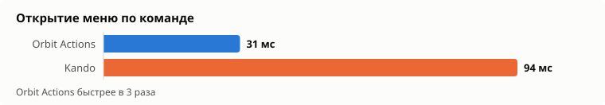
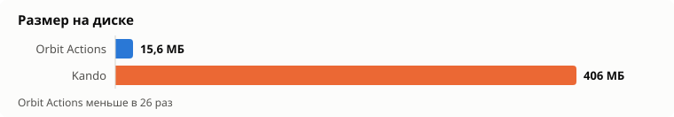
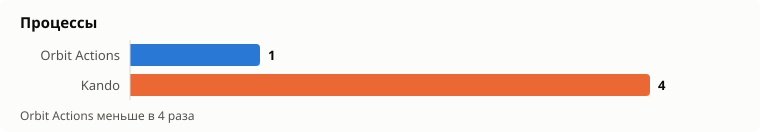
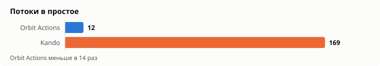
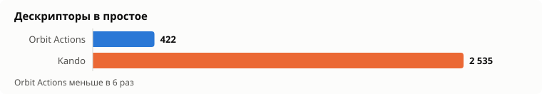

### Как считались цифры

Всё делает скрипт [`tools/bench.ps1`](tools/bench.ps1). Сырые результаты лежат в [`docs/results.json`](docs/results.json), графики из них рисует [`tools/charts.js`](tools/charts.js) сразу на английском и русском.

- **Память, потоки, дескрипторы** - сумма по всем процессам приложения. У Kando это главный процесс Electron плюс GPU, сетевой и рендер-процессы. Working set - сколько физической памяти занято сейчас, включая общие системные библиотеки. Private - память, которая принадлежит только этому приложению.
- **Простой** - 20 секунд после запуска. CPU считается по процессорному времени за следующие 60 секунд.
- **Запуск** - от старта exe до момента, когда приложение открыло свой IPC-порт и принимает подключения. Обе программы пишут этот порт в `%APPDATA%\kando\ipc-info.json`. Берётся медиана из 5 запусков. Первый холодный запуск Kando занял 12,3 с, в медиану он не попал.
- **Открытие меню** - от вызова `exe --menu "<имя>"` до появления видимого окна меню, медиана из 5 раз. В это время входит запуск второго экземпляра, который передаёт команду уже работающему. По горячей клавише меню открывается без этого шага, поэтому быстрее у обоих.
- **Настройки** - память через 8 секунд после `--settings`. У Orbit Actions это отдельный `orbit-actions-settings.exe`. Большую часть его памяти занимает OpenGL-драйвер видеокарты. Процесс живёт, только пока открыто окно настроек.
- **Размер на диске** - у Orbit Actions два exe, у Kando - распакованная папка из zip.

Повторить замеры:

```powershell
powershell -ExecutionPolicy Bypass -File tools\bench.ps1 -Kando "C:\путь\к\распакованному\Kando"
node tools\charts.js
```

Скрипт закрывает обе программы, по очереди запускает их и сам открывает меню. Пока он работает (около 6 минут), мышь и клавиатуру лучше не трогать. Конфигурацию Kando скрипт читает из `%APPDATA%\kando`, туда нужно заранее положить те же `menus.json` и `config.json`.

## Как это устроено

Два исполняемых файла:

- `orbit-actions.exe` - само меню. Работает постоянно, занимает около 6 МБ собственной памяти.
- `orbit-actions-settings.exe` - окно настроек. Запускается только на время редактирования меню.

Меню - одно невидимое многослойное окно (`WS_EX_LAYERED`) поверх всех остальных. Кадр рисуется программно через [tiny-skia](https://github.com/RazrFalcon/tiny-skia) в обычный буфер и выводится одним вызовом `UpdateLayeredWindow` с попиксельной прозрачностью. Браузерного движка, DOM, CSS и JavaScript нет: геометрия, анимации и пять тем Kando переписаны как код на Rust.

Ввод - глобальные хуки мыши и клавиатуры (`WH_MOUSE_LL`, `WH_KEYBOARD_LL`), `RegisterHotKey` для сочетаний клавиш и XInput для геймпада. Пока меню открыто, оно забирает только нужные ему клавиши: буквы, цифры, стрелки, Enter и Esc. Сочетания с Ctrl, Shift, Alt или Win и клавиши вроде Print Screen по-прежнему доходят до других программ. Если программу запустить второй раз, она находит уже работающий экземпляр, передаёт ему команду через `WM_COPYDATA` и сразу завершается. Для совместимости с внешними скриптами Kando открыт тот же WebSocket-API (`show-menu`, `show-custom-menu`) на локальном порту.

Окно настроек сделано на [egui](https://github.com/emilk/egui) через OpenGL, с фоном Mica из Windows 11.

## Что применено для скорости и памяти, и зачем

| Приём | Зачем |
|---|---|
| Нативный Win32 вместо Electron | Electron запускает целый Chromium: несколько процессов, сотни мегабайт и секунды на старт. Именно это давало 444 МБ в простое. |
| Программная отрисовка tiny-skia + `UpdateLayeredWindow` | Для прозрачного круглого меню не нужен ни GPU-контекст, ни композитор браузера. Кадр меню - это несколько сотен килобайт пикселей, процессор рисует его быстрее, чем видеокарта успевает проснуться. |
| Настройки в отдельном процессе | Интерфейсу настроек нужны OpenGL и egui, это около 120 МБ. Если держать их внутри меню, эта память занята всегда. Отдельный exe отдаёт её системе сразу после закрытия окна. |
| Таймер кадров только во время анимации | Таймер на 8 мс включается, только пока что-то движется, и выключается, когда меню замерло или закрыто. Поэтому в простое процессор не тратится совсем. |
| `timeBeginPeriod(1)` только пока меню открыто | Точный системный таймер нужен для плавной анимации, но в простое он мешает процессору засыпать и тратит батарею ноутбука. Включается при открытии меню, выключается при закрытии. |
| Опрос геймпада только при открытом меню | XInput опрашивается каждые 16 мс, только пока меню на экране. |
| Шрифты прогреваются в фоне при старте | Шрифты иконок Material Symbols и Simple Icons разбираются в отдельном потоке, чтобы первое открытие меню не ждало их загрузки. |
| Иконки как глифы шрифта, а не тысячи SVG-файлов | Тысячи иконок Material и Simple Icons хранятся как два TTF-шрифта с таблицей «имя → глиф», а рисуются в точном нужном размере. |
| Кэши с ограничением размера | Кэш масок иконок сбрасывается после 4 МБ или 256 записей, поэтому память не растёт со временем. После 20 открытий меню она выросла всего на 0,5 МБ. |
| Один буфер кадра на всё время | DIB-буфер для окна создаётся один раз и только увеличивается при необходимости, а не выделяется заново каждый кадр. |
| Звуки через `PlaySoundW` из памяти | Короткие WAV проигрываются системным вызовом, без аудиодвижка. |
| Все ресурсы внутри exe | Переводы, темы, иконки, звуки и шрифты встроены через `include_bytes!`. Нет сотен мелких файлов и чтения диска при старте. |
| Релизная сборка: LTO, `codegen-units = 1`, `panic = "abort"`, `strip` | Меньше и быстрее exe: компилятор оптимизирует программу целиком, а лишние таблицы и отладочные символы выбрасываются. |
| SVG вместо PNG | Картинки интерфейса векторные и рендерятся ровно под нужный размер и DPI, а не масштабируют растр. |

## Чего нет и почему

- **Собственные CSS-темы меню.** В Kando меню рисует Chromium, поэтому тема может быть любым HTML и CSS. Чтобы поддержать то же самое, пришлось бы встроить WebView2, а это больше 100 МБ памяти и несколько дополнительных процессов. Тогда пропадает весь смысл форка. Поэтому доступны только пять встроенных тем: Default, Clean Circle, Neon Lights, Purity и Rainbow Labels. Они нарисованы нативно, с пресетами цветов и светлым и тёмным вариантами.
- **CSS-темы окна настроек.** По той же причине: окно настроек сделано на egui, а не в браузере. Вместо тем у него монохромная палитра на фоне Mica.
- **Видео во вводном туториале и «сакура»-фоны настроек.** Это оформление самого Kando. Видео пришлось бы декодировать в отдельном медиастеке, а польза от него небольшая. Вместо видео туториал использует SVG-иллюстрации.
- **Достижения.** Они добавляют статистику и уведомления, но не делают меню удобнее. Это лишний код и фоновая работа.
- **Linux и macOS.** Меню, ввод, окна, трей и иконки приложений написаны напрямую на Win32 API: так получилось одно лёгкое окно и ноль фоновой нагрузки. На других системах всё это пришлось бы писать заново под X11/Wayland и Cocoa. Для Linux и macOS по-прежнему есть сам Kando.
- **PNG-ресурсы.** В интерфейсе используются только SVG и WebP: SVG чётко выглядит при любом масштабе, WebP занимает меньше места.

## Возможности

Меню (`orbit-actions.exe`):

- Круговая раскладка с фиксированными углами, подменю, расстоянием до родителя и удержанием в пределах монитора
- Выбор кликом, marking mode, turbo mode, жесты, клавиатура и геймпад (XInput)
- Пять тем меню с пресетами цветов, светлым и тёмным вариантами, секторами выбора и подсказками клавиш быстрого выбора
- Звуковые темы с громкостью и высотой звука
- Иконки: Material Symbols Rounded, Simple Icons (обычные и цветные), встроенные иконки действий, эмодзи, base64-картинки, установленные приложения и папки с иконками пользователя
- Действия на выбор, открытие, наведение и активацию: закрыть меню, закрыть подменю, задержка, выполнить команду, макрос, переключиться на окно, отключить сочетания клавиш, открыть файл, открыть меню, открыть настройки, открыть ссылку, отправить WebSocket-сообщение, скопировать в буфер, нажать сочетание клавиш
- Условия показа меню: приложение, заголовок окна, область экрана
- Кнопка настроек на экране, меню в трее, ссылки `orbit-actions://`, проверка обновлений
- Необязательный вызов по Alt + левый клик
- Команды, которые запускают `.bat` и `.cmd`, открываются в своей консоли. Остальные команды выполняются без окна.

Настройки (`orbit-actions-settings.exe`):

- Список меню с коллекциями, поиском, импортом и экспортом
- Интерактивный предпросмотр меню с перетаскиванием, фиксацией углов и шаблонами пунктов
- Редакторы пунктов, меню и действий с записью сочетаний клавиш и макросов, выбором приложения и окна
- Общие настройки, настройки темы, вводный туториал, отмена и повтор
- Переводы на 30 языков

## Конфигурация

Меню и настройки хранятся в `menus.json` и `config.json` рядом с программой. Формат совместим с Kando 3, так что существующую конфигурацию Kando можно просто скопировать. При первом запуске Orbit Actions сам подхватывает `%APPDATA%\kando\menus.json`, если такой файл есть.

## Сборка

Нужен Rust (stable) и Visual Studio Build Tools с компонентом C++.

```
cargo build --release
```

Другие архитектуры:

```
rustup target add i686-pc-windows-msvc aarch64-pc-windows-msvc
cargo build --release --target i686-pc-windows-msvc
cargo build --release --target aarch64-pc-windows-msvc
```

Для ARM64 в Visual Studio Installer нужен компонент «MSVC ARM64 build tools».

Установщик собирается [Inno Setup 6](https://jrsoftware.org/isinfo.php) из `installer/orbit-actions.iss`, после того как готовы все три сборки:

```
iscc installer\orbit-actions.iss
```

Готовый `Orbit-Actions-<версия>-setup.exe` появится в `target\installer`.

Шрифты `assets/material.ttf` и `assets/simple.ttf` и таблицы иконок генерирует `tools/icons.py`, ему нужны `fonttools` и `brotli`.

## Лицензия

Orbit Actions распространяется по лицензии MIT, см. [LICENSE](LICENSE). Он основан на Kando, который тоже под MIT. Сторонние ресурсы сохраняют свои лицензии, см. [THIRD_PARTY.md](THIRD_PARTY.md).
